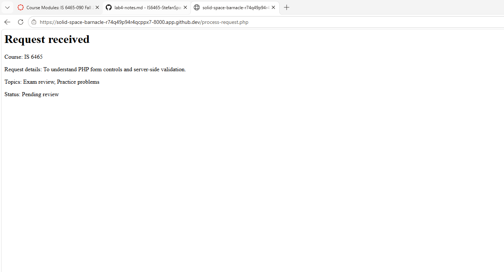

## Part 1: Run the application

I submitted the tutoring request for IS 6465 and selected the requested variables. After submitting the form, the application displayed a "Request received" confirmation page showing the course, request details, selected topics, and a status of "Pending review." The request was accepted without any validation errors.

## Part 2: Trace the templates

1. What content does header.php provide to every page? 
    header.php file provides the basic HTML structure for each page, including the document type, character encoding, and viewport settings. It also links to Bootstrap and the shared CSS stylesheet and sets the page title to "Peer Tutoring Hub."
2. What content does nav.php provide?
    nav.php file provides the shared navigation bar for the Peer Tutoring Hub. It includes links to the main page, the requests page, and the form to request a tutoring session. Using a shared navigation file keeps the menu consistent across the application.
3. What content does footer.php provide? 
    footer.php file provides the shared footer displaying "Peer Tutoring Hub" at the bottom of each page. It also loads the Bootstrap JavaScript bundle and contains the closing HTML tags to complete the page structure.
4. Why is require_once appropriate for these files?
    PHP's require_once allows multiple pages to use the same header, navigation, and footer files without duplicating their code. It also ensures that each file is included only once during a request and helps maintain consistency and makes the application easier to update.
5. Where is the shared CSS file linked?
    The shared CSS file is linked in includes/header.php on line 7. This allows all pages using the shared header to access the same stylesheet without adding the CSS link to each page separately.

## Part 3: Observe the form controls
1. reason: 
    The reason control uses a textarea that allows the user to enter a description of what they need tutoring assistance with. The field is required and allows up to 500 characters. When submitted, PHP receives the entered text as a single string.
2. topics[]:
    The topics[] control uses checkboxes that allow users to select multiple topics they need assistance with, such as Exam review, Practice problems, and Study plan. The selected values are submitted to PHP as an array because multiple options can be selected.
3. preferredtime:
    The preferredtime control uses radio buttons that allow users to select one preferred time for their tutoring session: Morning, Afternoon, or Evening. Since only one option can be selected, PHP receives the selected value as a single string.
4. preferreddate:
    The preferreddate control uses a date input that allows users to select their preferred tutoring session date. PHP receives the selected date as a single string.
5. form_name:
    The form_name control is a hidden field that identifies the form being submitted as a tutoring request. PHP receives the value "tutoring_request" as a single string. Although the field is hidden from the user, its value can still be modified and must be validated by PHP.

## Part 4: Test validation behavior

Test: Valid request
1. Values entered: 
    Course: IS6465; Topics: Exam review and Practice problems; Preferred time: Morning; Preferred date: October 27, 2026; Reason: "To understand PHP form controls and server-side validation."
2. Result: 
    The request was accepted.
3. Application message: 
    "Request received" with a status of "Pending review."
4. Businesss rule": 
    The course must be approved, at least one valid topic must be selected, a preferred time must be selected, the reason must contain 10–500 characters, and the preferred date must be valid and not in the past.

Test: Missing or invalid value
1. Values entered: 
    Course: IS6465; Topics: Exam review and Practice problems; Preferred time: Morning; Preferred date: October 27, 2026; Reason: Left blank.
2. Result: 
    The request was rejected by the browser before being submitted to PHP.
3. Application message: 
    The browser displayed "Please fill out this field."
4. Business rule: 
    The reason field is required and must contain between 10 and 500 characters. The browser enforced the required field, preventing submission.

Test: Past date
1. Values entered: 
    Course: IS 6465; Topics: Exam review and Practice problems; Preferred time: Morning; Preferred date: October 25, 2026; Reason: "To understand PHP form controls and server-side validation."
2. Result: 
    The request was rejected by PHP's server-side validation.
3. Application message: 
    "Request could not be submitted" followed by "Preferred date cannot be in the past."
4. Business rule: 
    The preferred date must be a valid date that is not earlier than the current date. Since October 25, 2026, was before October 27, 2026, the application rejected the request.

## Part 5: Review testing and CRUD pages

1. tests/validation-tests.php
    I opened tests/validation-tests.php and ran the automated validation tests. All 10 tests passed successfully. The tests checked valid, missing, and altered preferred times; multiple, missing, and altered topics; and minimum, maximum, too short, and too long reason lengths. The results indicate that the validation functions returned the expected outcomes for all tested conditions.
2. CRUD action/Pages
    Create - request-form.php and process-request.php
    Read one request - request-details.php
    Read all requests - requests.php
    Update - edit-request.php
    Delete - delete-request.php

1. What query parameter appears in the request details URL?
    request_id, with a value of 12.
2. Why is a GET query parameter appropriate for viewing one request?
    The user is retrieving information about an existing request without changing the application data.
3. Why should an actual update or delete later use POST rather than GET?
    POST is appropriate for actions that change application data. GET requests are intended for retrieving information and can be triggered by following links, browser previews, or other automated requests. Using POST helps prevent unintended changes, although additional security protections are still necessary.