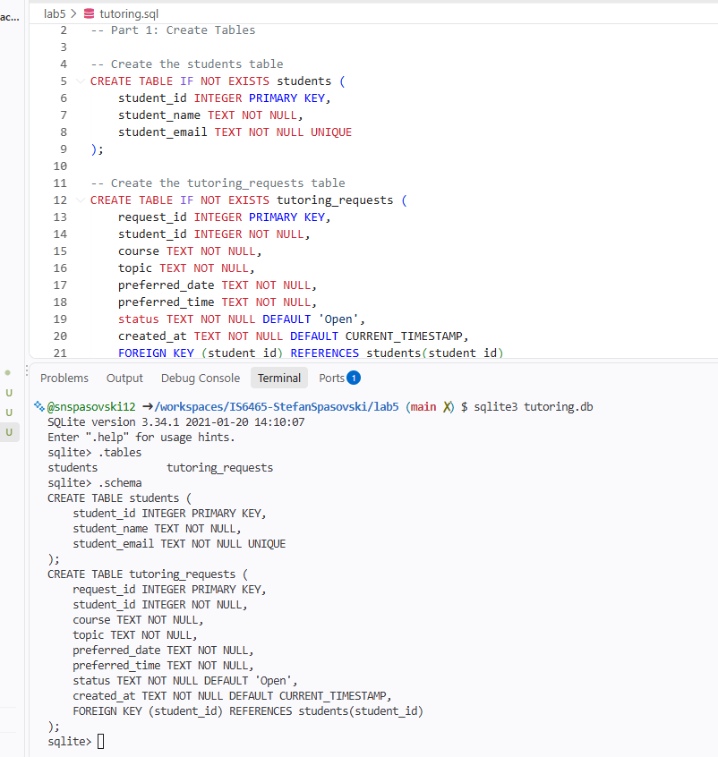
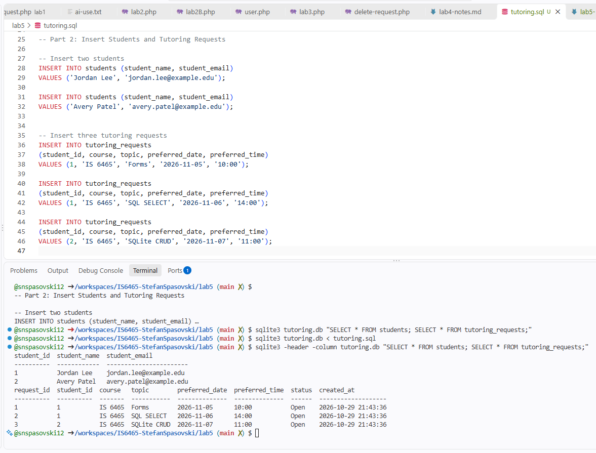
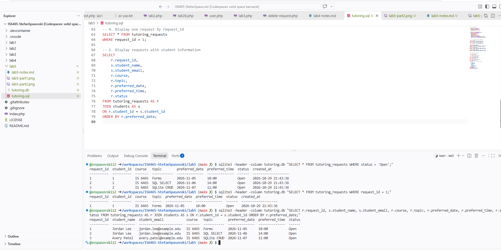
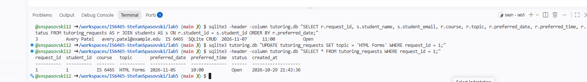
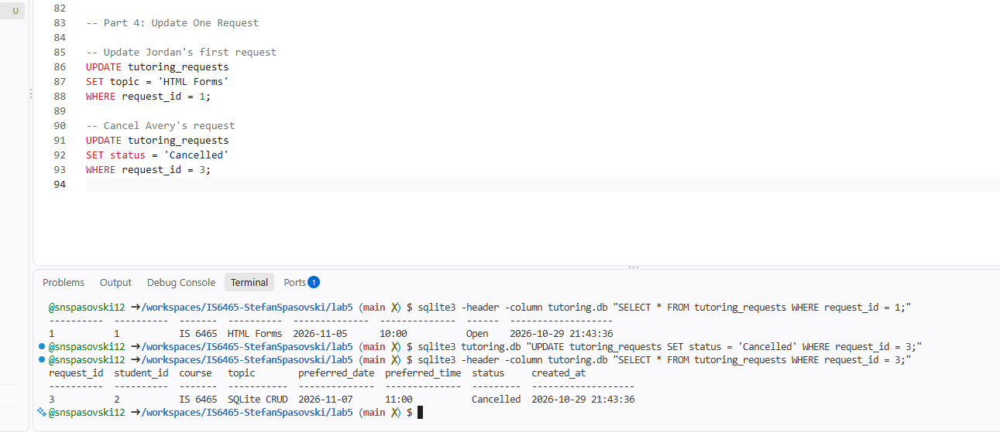
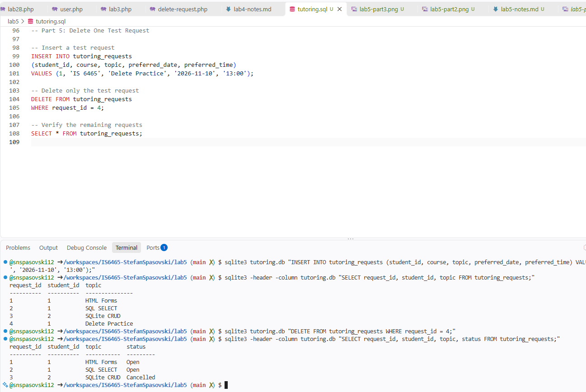

## Part 1: Create the database tables
1. 

2. The primary key in the students table is student_id. The primary key for the tutoring_requests table is request_id.

3. The foreign key is student_id in the tutoring_requests table. It references student_id in the students table, creating a one to many relationship. 

4. To prevent multiple student records from using the same email address. 

## Part 2: Insert students and tutoring request
1.
```sql
 INSERT INTO students (student_name, student_email)
VALUES ('Jordan Lee', 'jordan.lee@example.edu');

INSERT INTO students (student_name, student_email)
VALUES ('Avery Patel', 'avery.patel@example.edu');

-- Insert three tutoring requests
INSERT INTO tutoring_requests
(student_id, course, topic, preferred_date, preferred_time)
VALUES (1, 'IS 6465', 'Forms', '2026-11-05', '10:00');

INSERT INTO tutoring_requests
(student_id, course, topic, preferred_date, preferred_time)
VALUES (1, 'IS 6465', 'SQL SELECT', '2026-11-06', '14:00');

INSERT INTO tutoring_requests
(student_id, course, topic, preferred_date, preferred_time)
VALUES (2, 'IS 6465', 'SQLite CRUD', '2026-11-07', '11:00');
```

2. 

3. Theres only one row in the student table becuase each student only needs one record. He has two request rows because he submitted two seperate requests. Both requests
are connected to Jordan through his student_id.

## Part 3: Read the stored data




```sql
SELECT
    r.request_id,
    s.student_name,
    s.student_email,
    r.course,
    r.topic,
    r.preferred_date,
    r.preferred_time,
    r.status
FROM tutoring_requests AS r
JOIN students AS s
ON r.student_id = s.student_id
ORDER BY r.preferred_date;
```

1. The JOIN condition connects the students and tutoring_requests tables using student_id.

2. JOIN combines related information from two tables, while WHERE filters the results to show only records that meet a specific condition.

3. The application should use request_id because it uniquely identifies each request. Multiple requests may have the same topic, so searching by topic alone could return multiple records.


## Part 4: Update One Request

1. The two UPDATE statements:

   ```sql
   UPDATE tutoring_requests
   SET topic = 'HTML Forms'
   WHERE request_id = 1;

   UPDATE tutoring_requests
   SET status = 'Cancelled'
   WHERE request_id = 3;
   ```

2. 

3. 

4. It ensures that only the intended record is updated. Without WHERE, the UPDATE statement could change every record in the table.
  
5. It uses a Cancelled status to preserve the request history instead of permanently deleting the information.
   
## Part 5: Delete One Test Request

1. INSERT statement:

   ```sql
   INSERT INTO tutoring_requests
   (student_id, course, topic, preferred_date, preferred_time)
   VALUES (1, 'IS 6465', 'Delete Practice', '2026-11-10', '13:00');

2. DELETE statement:

```sql
DELETE FROM tutoring_requests
WHERE request_id = 4;
```

3. 

4. A WHERE clause ensures that only the intended record is deleted. Without WHERE, the DELETE statement could remove every record from the table.


## Part 6: Reflect on the CRUD Workflow

| CRUD Action | SQL Statement Used | Peer Tutoring Hub Example |
|---|---|---|
| Create      | INSERT             | Added Jordan and Avery's tutoring requests |
| Read        | SELECT             | Viewed saved tutoring requests |
| Update      | UPDATE             | Changed Jordan's topic to HTML Forms and Avery's status to Cancelled |
| Delete      | DELETE             | Removed the Delete Practice test request |

1. It uses student_id as a primary key in the students table and a foreign key in the tutoring_requests table. This allows one student to have multiple requests.

2. The UNIQUE constraint prevents two student records from having the same email address.

3. Without a WHERE clause, an UPDATE statement could change every record, or a DELETE statement could remove every record in the table.

4. PHP should use parameters to keep user input separate from SQL commands. This helps prevent SQL injection attacks and makes the application more secure.
