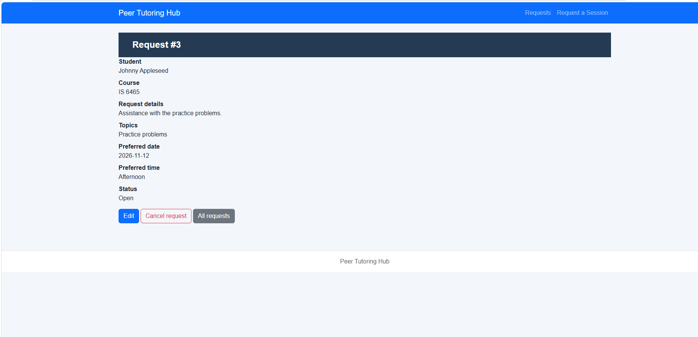
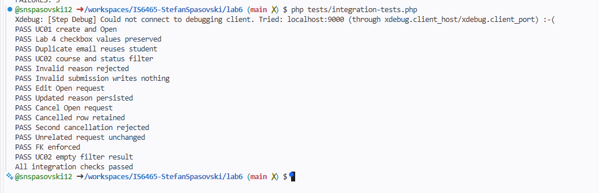

# Lab 6 — PHP, PDO, and SQLite Integration

## Part 1: Set Up the Database Setup

Command Used to create the database:
`sqlite3 database/tutoring.db < database/setup-database.sql`

Command to open the datatbase:
`sqlite3 database/tutoring.db`

Command to verify both tables exist:
`.tables`

Both tables, students and tutoring_requests, appeared when I ran the .tables command.

## Part 2: Run the Application

1. URL Used: https://solid-space-barnacle-r74q49p94r4qcppx7-8000.app.github.dev/php/request-form.php
2. I can confirm that I submitted a request for Johnny Appleseed in the IS 6465 course. The application saved the request as "Request #3 and dispalyed the information with a status of open.
3. 

## Part 3: Application Workflow Testing

| Test | What I Did | Expected Result | Actual Result | Pass or Fail |
|---|---|---|---|---|
| Submit a valid request | Submitted a request for Johnny Appleseed | New request created with Open status | Request #3 created with Open status | Pass |
| View all requests | Clicked All requests | New request appears in list | Request #3 appeared in list | Pass |
| Filter requests | Filtered by IS 6465 and Open | Matching requests displayed | Four matching requests displayed | Pass |
| Edit an Open request | Edited Request #3 details | Revised values displayed | Updated details displayed | Pass |
| Cancel an Open request | Cancelled Request #3 | Status changes to Cancelled | Request #3 showed Cancelled | Pass |
| Try to edit or cancel a cancelled request | Opened Request #3 after cancellation | Application does not allow changes | Edit and Cancel buttons unavailable | Pass |

## Part 4: Trace the Request Submission Workflow

1. 	`php/request-form.php`
2. 	`php/process-request.php`
3.  `config/db.php`
4.  `services/requestService.php`
5.  `repositories/studentPDO.php and repositories/requestPDO.php`
6.  `students`
7.  `tutoring_requests`
8.  student_id is the primary key in students and a foreign key in tutoring_requests.

# Why SQL statements belong in repository files rather than directly in the form page.
SQL statements belong in repository files because they separate database operations from the HTML presentation layer. This makes the application easier to maintain, test, and troubleshoot because each file has a specific responsibility. The form handles user input and display, while the repository files handle retrieving and updating information in SQLite.

## Part 5: Run the Integration Tests

```text
PASS UC01 create and Open
PASS Lab 4 checkbox values preserved
PASS Duplicate email reuses student
PASS UC02 course and status filter
PASS Invalid reason rejected
PASS Invalid submission writes nothing
PASS Edit Open request
PASS Updated reason persisted
PASS Cancel Open request
PASS Cancelled row retained
PASS Second cancellation rejected
PASS Unrelated request unchanged
PASS FK enforced
PASS UC02 empty filter result
All integration checks passed
```



## Part 6: Use the AI Skills Pack Process

### Application Builder

**AI Prompt:**

Explain how a tutoring request moves from php/request-form.php through PHP, PDO, and SQLite in this project. Identify the responsibility of each file.

**AI Response:**

A new request follows this path:

request-form.php → process-request.php → requestService.php → PDO connection and repository functions → SQLite → request-details.php

- request-form.php displays the form. Its field names become the POST data, and its action sends that data to process-request.php.
- process-request.php is the submission entry point. It requires a POST request and the expected form marker, opens the database, and calls the service. On success, it redirects to the new request’s details page; it returns validation errors as 422 responses and logs unexpected errors.
- requestService.php contains the application logic: validates the submitted values, maps the form fields to database fields, and manages the transaction. It inserts or reuses the student, looks up that student’s ID, and creates the request. If any step fails, it rolls back the transaction. The reason and selected topics are encoded together as JSON in the topic field.
- validation.php provides checks for allowed times and topics and for the reason’s length. The service also validates the course, email, and date.
- db.php creates the PDO connection using a SQLite DSN pointing to database/tutoring.db. It enables exception-based PDO errors, associative fetches, and SQLite foreign-key enforcement.
- studentPDO.php holds the student SQL operations: insert a student only if their unique email is not already present, then find them by email.
- requestPDO.php holds request SQL operations, including inserting the tutoring request and returning its generated ID.
- setup-database.sql defines the students and tutoring_requests tables, their keys and constraints, and initial sample data. The SQLite database file is tutoring.db.
- request-details.php handles the redirect’s destination: it fetches the saved request and student through the repository, decodes the JSON topic value, and displays the confirmation.

The PDO repositories use prepared statements, keeping SQL operations separate from form presentation. The student row is saved first so the request can reference its student_id via the foreign key.

**My Evaluation:**

The AI correctly identified that studentPDO.php handles finding or creating student records. I verified this by reviewing the findStudentByEmail() and insertStudentIfAbsent() functions in studentPDO.php. Both functions use PDO prepared statements to interact with the students table.

### Traceability Author

**AI Prompt:**

Trace the requirement “a student can submit a tutoring request” through the PHP files, service, repositories, SQLite tables, and integration tests in this project.

**AI Response:**

The requirement—a student can submit a tutoring request—is implemented across the form, request handler, service, repositories, and SQLite schema:

1. Collect the request: request-form.php presents fields for the student’s name and email, course, preferred date and time, reason, and selected topics. The form posts these values to process-request.php.

2. Handle the submission: process-request.php accepts only POST requests with the expected form marker, opens the database, and passes the submitted data to submitRequest. On success, it redirects to the new request’s details page. Validation failures produce a 422 response; unexpected failures are logged and return a 500 response.

3. Validate and coordinate the work: requestService.php validates required student details, course, date, time, topics, and reason. It packages the reason and topics as JSON in the topic field, then uses a transaction to insert or reuse the student, find that student’s ID, and create the request. If an operation fails, it rolls back the transaction. validation.php supplies checks for valid time choices, topics, and reason length.

4. Connect through PDO: db.php creates a PDO connection to the SQLite database, enables exceptions and associative fetches, and turns on SQLite foreign-key enforcement.

5. Run database operations: studentPDO.php inserts a student only if their email is not already present and looks them up by email. requestPDO.php inserts the request using the student ID and returns its generated request ID. Both use prepared statements.

6. Persist related records: setup-database.sql defines students and tutoring_requests. A student’s student_id is the primary key; student_email is unique. Each tutoring request has its own primary key and a student_id foreign key referring to students, so a request is associated with a valid student. New requests default to Open.

7. Show the result: request-details.php retrieves the saved request and student, decodes the JSON topic value, and displays the confirmation.

The integration checks in integration-tests.php create an in-memory SQLite database from the schema and call the service directly. They verify that a valid request is created with Open status, topics persist, a repeated email reuses the student, invalid input writes nothing, and foreign-key enforcement rejects a request for a nonexistent student. These tests exercise the service and database layers, not the browser form or HTTP handler. The notes also record a separate manual form submission that produced Request #3 with Open status in lab6-notes.md.

**Requirements Traceability Table:**

| Requirement | Application Page | Service or Validation | Repository or SQL | Database Table | Test Evidence |
|---|---|---|---|---|---|
| Student submits a tutoring request | `php/request-form.php` and `php/process-request.php` | `services/requestService.php` and `includes/validation.php` | `repositories/studentPDO.php` and `repositories/requestPDO.php` | `students` and `tutoring_requests` | `tests/integration-tests.php`: UC01 create and Open — PASS |

### Test Harnesss Generator

**AI Prompt:**

Suggest one useful test case for the Peer Tutoring Hub application. The test must relate to request creation, filtering, editing, cancellation, validation, or database integrity.

**AI Response:**

Test case: Reject a past preferred date without writing to the database.

In integration-tests.php, copy the valid sample request, set preferreddate to yesterday, and call submitRequest. Expect an InvalidArgumentException and verify the counts of both students and tutoring_requests are unchanged. This covers the past-date validation in requestService.php and ensures invalid submissions don’t create database records.

1. The test checks for invalid reasons and whether invalid submissions create database records. Unfortunately, I did not identify a specific test for rejecting a past preferred date.

2.  I would submit a tutoring request with a preferred date in the past and verify that the application rejects it. I would then check the database to confirm that no new tutoring request was created. This could also be added to integration-tests.php using a temporary SQLite database.

3. Yes, this is a useful test because it checks date validation and ensures invalid requests are not saved.

### Skills Pack Reflection

Using AI helped me better understand how the different PHP files work together to process tutoring requests and interact with the SQLit  database. The traceability exercise helped me connect the application requirements to the specific files, database tables, and integration tests. AI also suggested testing whether the application rejects past dates, which I verified was already part of the validation code but was not specifically covered by the integration tests. This showed me why it is important to review AI-generated responses against the actual code and requirements rather than assuming the information is correct.

## Part 7: Inspect the Database

The SQL JOIN combines information from the tutoring_requests and students tables using the shared student_id field. This allows the query to display each student's name and email alongside their tutoring request information without duplicating student details in the requests table. The results are then ordered by request ID.